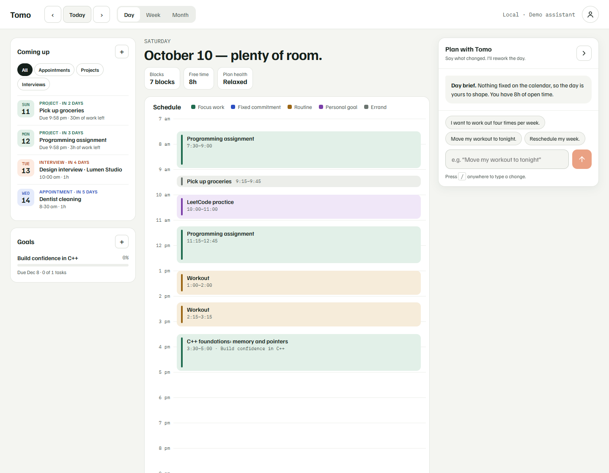
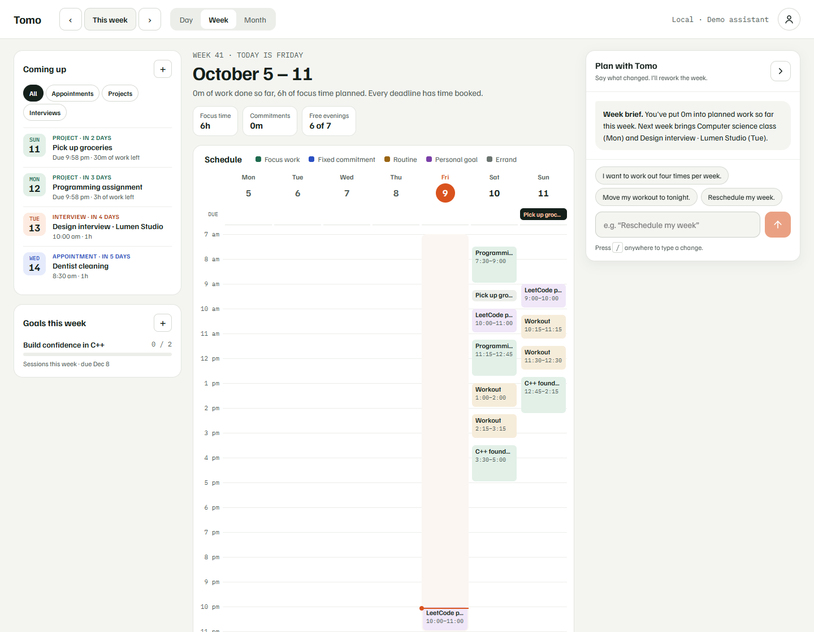
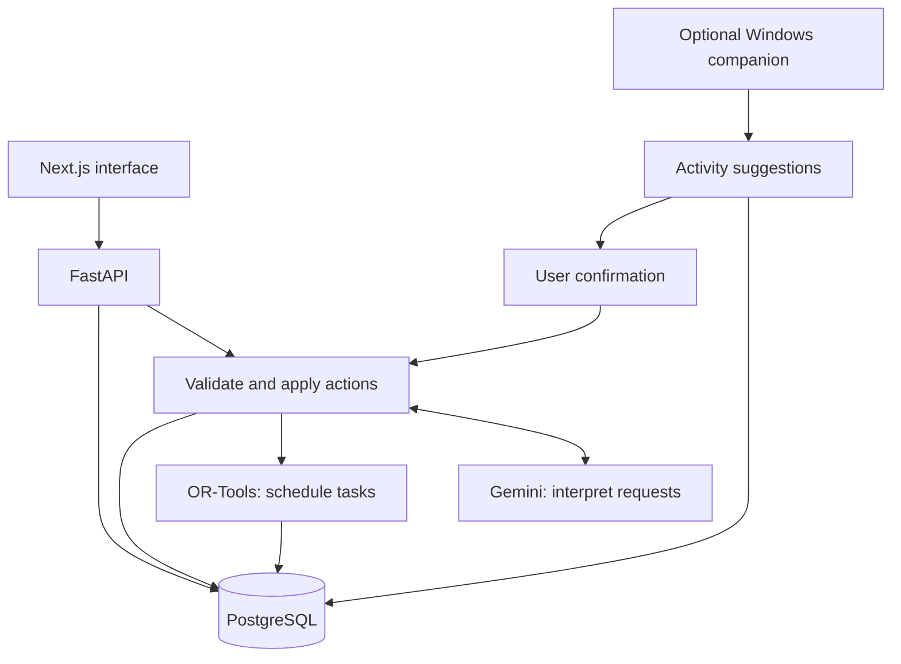

# Tomo

Plan tasks, routines, and deadlines in one calendar. Say what changed and Tomo reworks your day.





## Features

- Day, week and month views, color-coded as focus work, fixed commitments, routines, personal goals and errands.
- **Coming up** lists appointments, interviews and project deadlines for the next three weeks, flagging deadline work that isn't scheduled yet.
- **Goals** shows progress per goal (overall in Day view, sessions finished in Week view).
- **Plan with Tomo**: describe a change in chat and get a proposal. The changed blocks are shown dashed on the calendar; apply it, discard it, or undo it afterwards. Press <kbd>/</kbd> anywhere to type.
- The plan maintains itself: edits replan the week, the horizon rolls forward each day, and elapsed sessions count as done.
- Connect calendar feeds in Settings: Canvas (its Calendar Feed link, no access token needed), Google Calendar, Outlook, Apple iCloud or any `.ics` link. Events become fixed blocks Tomo plans around; assignments become due dates. Demo mode includes a sample Canvas feed.
- Optionally use the Windows companion for activity-based check-ins.

## Run locally

Requires Docker Desktop and Node.js 24. Run these commands from the repository root in PowerShell:

```powershell
Copy-Item .env.example .env
docker compose up --build -d
docker compose exec backend python -m app.seed
cd frontend
npm ci
npm run dev
```

Open [localhost:3000](http://localhost:3000), then choose **Try the demo**. The seed command adds sample data and is optional in the original local single-user setup. Demo mode works without an API key and supports the sample commands shown in chat. The local sign-in screen appears once Clerk keys are configured.

If a preview is already running, stop it with `.\scripts\stop-preview.ps1` first. Database data persists between container restarts.

### Use it from other devices at home

Run the frontend with `npm run lan` (from `frontend/`) instead of `npm run dev`. It builds the app and serves it on all network interfaces, so other devices on your network can open `http://<this-PC's-IP>:3000` (find the IP with `ipconfig`). The backend stays bound to this PC; the frontend relays API calls to it.

On Windows, other devices can only connect if your Wi-Fi uses the **Private** network profile and Node.js is allowed through Windows Firewall on private networks. There is no login: anyone on your network who opens the address can see and change your planner, so only use this on a network you trust.

### Enable Gemini

Set these backend values in the root `.env`:

```dotenv
AI_MODE=gemini
GEMINI_API_KEY=your-key
GEMINI_MODEL=gemini-2.5-flash
```

Then run `docker compose up -d --force-recreate backend`. Keep API keys out of Git.

For DeepSeek, set `AI_MODE=deepseek` and `DEEPSEEK_API_KEY` instead. Tomo uses the fast
`deepseek-chat` model and normally makes one AI call per request. Invalid model
responses may need one repair call. Set
`DEEPSEEK_PLANNER_MODEL=deepseek-reasoner` to use the reasoning model, or
`AI_REVIEW_ENABLED=true` to add a second AI review call for proposals. Both options
increase response time and token use. Provider latency and token counts are logged
by the backend at INFO level when usage data is returned by the API.

## Architecture



Gemini interprets requests; OR-Tools chooses feasible times. FastAPI validates every change, previews it as a proposal, and saves it to PostgreSQL only when you apply it. Activity suggestions require your confirmation before replanning.

See [architecture details](docs/ARCHITECTURE.md).

## Limitations

- Local Docker setup remains single-user. The hosted setup supports separate Clerk accounts and private demo workspaces; see [hosting](docs/HOSTING.md).
- Plans use 15-minute slots with a maximum 14-day horizon.
- Demo chat accepts limited commands (shown as chips under the chat). Live Gemini behavior has not been validated against the provider.
- Elapsed sessions are assumed done; tell the assistant if you skipped something. Calendar feeds import on a schedule but do not write changes back to Google, Canvas, or Outlook.
- Activity signals are estimates and never automatically mark work complete.

## Documentation

- [Development and tests](docs/DEVELOPMENT.md)
- [Architecture](docs/ARCHITECTURE.md)
- [Scheduling rules](docs/SCHEDULER.md)
- [API reference](docs/API.md)
- [Windows companion](docs/DESKTOP_AGENT.md)
- [Validation status](docs/IMPLEMENTATION_STATUS.md)
- [Hosting and GitHub deployments](docs/HOSTING.md)
